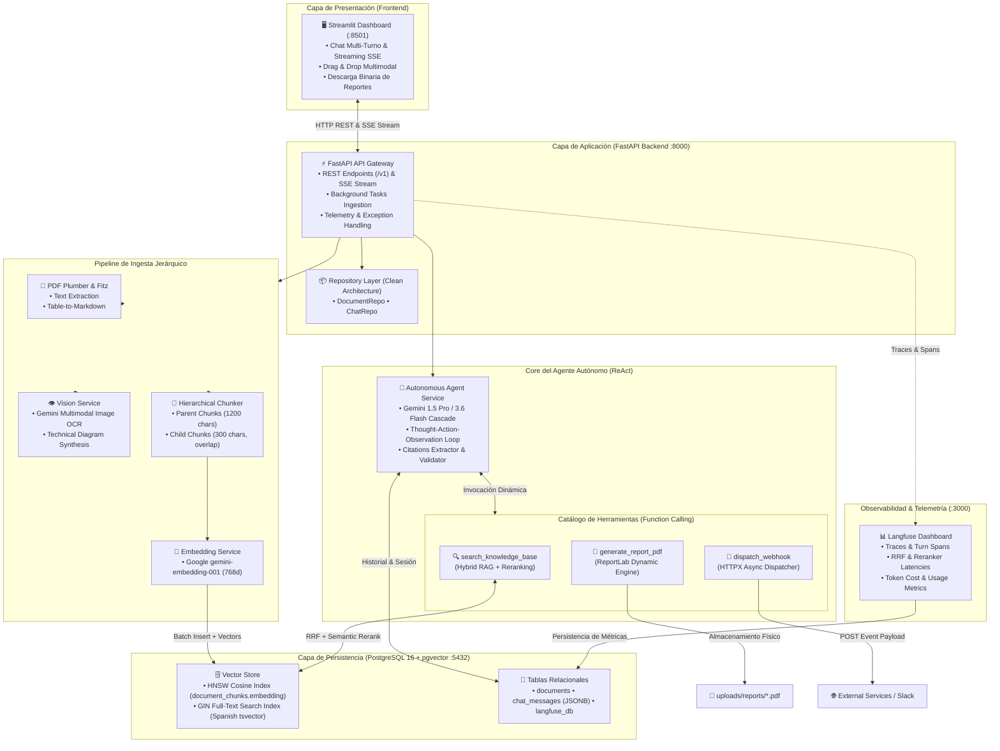

# 🚀 Autonomous Multimodal RAG Agent & Knowledge Engine

<div align="center">

[](https://www.python.org/)
[](https://fastapi.tiangolo.com/)
[](https://github.com/pgvector/pgvector)
[](https://ai.google.dev/)
[](https://streamlit.io/)
[](https://langfuse.com/)
[](https://www.docker.com/)

**Desarrollado por [Mattia Risso](https://github.com/MattMattia)**  
🔗 **Repositorio:** [https://github.com/MattMattia/multimodal-rag-agent](https://github.com/MattMattia/multimodal-rag-agent)

</div>

---

## 📌 1. Visión Ejecutiva

Sistema de Inteligencia Artificial empresarial de extremo a extremo que combina un pipeline de **Ingesta y Extracción Multimodal**, **Búsqueda Híbrida Avanzada (Dense Vector + Full-Text Search)**, **Reranking Semántico con LLM** y un **Agente IA Autónomo ReAct** con catálogo de herramientas dinámicas (Function Calling), memoria conversacional persistente y **Observabilidad de Nivel Empresarial con Langfuse**.

El sistema procesa documentos no estructurados y de alta complejidad (PDFs con maquetación heterogénea, tablas formateadas, diagramas técnicos y recibos/facturas), vectoriza el conocimiento preservando la jerarquía contextual mediante **Parent-Child Chunking**, y habilita la toma de decisiones autónoma mediante razonamiento multi-paso, generación dinámica de reportes ejecutivos en PDF, despacho de eventos vía webhooks y monitoreo en tiempo real de tokens y latencias.

---

## 🏗️ 2. Arquitectura del Sistema



---

## ⚙️ 3. Decisiones Clave de Ingeniería

### 1. Chunking Jerárquico Parent-Child
* **Desafío:** Los fragmentos pequeños maximizan la precisión semántica en la recuperación vectorial, pero pierden el contexto global necesario para que el LLM genere respuestas coherentes.
* **Solución:** Se implementó una estrategia en dos niveles:
  * **Child Chunks (250–300 caracteres, solapamiento de 50):** Utilizados como vectores de búsqueda granular en el índice vectorial.
  * **Parent Chunks (1000–1500 caracteres):** Cada fragmento hijo almacena un puntero `parent_id`. Al recuperarse un fragmento hijo relevante, el sistema expande automáticamente el texto al fragmento padre antes de sintetizar la respuesta final.

### 2. Búsqueda Híbrida Unificada con Reciprocal Rank Fusion (RRF)
* **Desafío:** La búsqueda puramente vectorial falla ante consultas con números de serie, acrónimos técnicos específicos o identificadores fiscales; la búsqueda léxica (BM25) ignora la semántica.
* **Solución:** Fusión bilingüe ejecutada en PostgreSQL:
  * **Búsqueda Vectorial Densa:** Distancia coseno sobre embeddings de 768 dimensiones optimizada con índices **HNSW** (`vector_cosine_ops`).
  * **Búsqueda Léxica Esparsa:** Motor de texto completo PostgreSQL con diccionarios en español e índices **GIN** (`to_tsvector`).
  * **RRF ($k = 60$):** Algoritmo de normalización no supervisado que combina los rankings sin requerir calibración manual de pesos:
    $$\text{Score}_{RRF}(d) = \sum_{m \in \{\text{vector}, \text{lexical}\}} \frac{1}{k + \text{rank}_m(d)}$$

### 3. Memoria Conversacional Persistente en Base de Datos
* **Desafío:** Pérdida de contexto en chats multi-turno sin saturar la ventana de contexto del LLM con llamadas redundantes a herramientas.
* **Solución:** Modelo relacional `ChatMessage` en PostgreSQL con almacenamiento estructurado en `JSONB` para `citations` y `executed_tools`. En turnos posteriores (ej. *"tradúcelo al inglés"* o *"resume lo anterior"*), el agente analiza la memoria de la sesión y resuelve la instrucción sin disparar consultas RAG redundantes.

### 4. Cascada de Resiliencia y Auto-Promoción de Modelos
* **Desafío:** Variaciones de cuota, spikes de latencia y deprecaciones en modelos de la API de Google (errores `404 NOT_FOUND` o `429 RESOURCE_EXHAUSTED`).
* **Solución:** Módulo con cascada transparente (`_call_gemini_with_fallback`):
  * Prioriza el modelo configurado (`gemini-1.5-pro` / `gemini-1.5-flash`).
  * Si la API notifica indisponibilidad, promueve la ejecución a variantes de alta velocidad con cuota estable (`gemini-3.6-flash`, `gemini-3.5-flash`, `gemini-3.1-flash-lite`).
  * Recuerda el modelo operativo para el resto de la sesión y cuenta con respaldo de contingencia con trazabilidad explícita (`logger.error`).

### 5. Reportes PDF Dinámicos con ReportLab
* **Desafío:** Generación de informes sin recurrir a plantillas fijas estáticas.
* **Solución:** La herramienta `generate_report_pdf` recibe argumentos dinámicos formulados por el LLM tras analizar el corpus: título contextualizado, síntesis ejecutiva estructurada y puntos de acción concretos, entregando el archivo listo para descarga directa.

### 6. Streaming en Tiempo Real (SSE) en FastAPI y Streamlit
* **Desafío:** La latencia percibida en respuestas generativas complejas con invocación multi-herramienta.
* **Solución:** Endpoint `POST /api/v1/agent/chat/stream` que emite Server-Sent Events (SSE) estructurados (`token` y `metadata`), consumido progresivamente por Streamlit con `st.write_stream` para una experiencia interactiva sin fricciones.

### 7. Reranking Semántico Posterior a RRF
* **Desafío:** Aunque RRF combina de manera equilibrada señales densas y esparsas, fragmentos que contienen palabras clave pero no responden semánticamente a la intención del usuario pueden posicionarse alto en el ranking inicial.
* **Solución:** `RerankerService` implementa una etapa de scoring semántico posterior a RRF:
  * Recupera una ventana extendida de candidatos (`top_k * 3`).
  * Califica la relevancia semántica de cada fragmento (escala 0.0 a 1.0) mediante Gemini, asignando `rerank_score`.
  * Reduce la selección a los mejores `top_k` y expande el contexto al fragmento padre (`Parent-Document Retrieval`).
  * **Fallback determinístico:** Ante timeouts o indisponibilidad de API, preserva de forma transparente el orden RRF original sin degradar el servicio.

#### 8. Observabilidad y Telemetría de LLM con Langfuse
* **Desafío:** Monitorear el comportamiento autónomo del agente ReAct en entornos de producción: auditar qué herramientas ejecuta, qué fragmentos recupera, la latencia de cada etapa y el consumo exacto de tokens y costos sin penalizar el rendimiento ni bloquear el flujo del usuario.
* **Solución:** Módulo desacoplado `TelemetryService` (`app/core/telemetry.py`):
  * **Contenedor auto-hospedado:** Servicio web de Langfuse integrado en `docker-compose.yml` (`:3000`) con persistencia en PostgreSQL (`langfuse_db`).
  * **Trazabilidad de Turnos:** Cada consulta del usuario genera un `Trace` raíz asociando el `session_id`.
  * **Spans de Ejecución:** Instrumentación contextual automática de herramientas (`search_knowledge_base`, `generate_report_pdf`, `dispatch_webhook`), búsqueda vectorial RRF y la fase de reranking semántico.
  * **Métricas de Generación:** Registro granular de modelos Gemini invocados, prompts procesados, tokens de entrada/salida y latencia en segundos.
  * **Resiliencia Total (No-Op Fallback):** Si Langfuse está deshabilitado (`LANGFUSE_ENABLED=false`) o el servidor está temporalmente inaccesible, `DummyTrace` y `DummySpan` garantizan latencia 0 ms sin arrojar excepciones al cliente.

---

## 🚀 4. Guía de Inicio Rápido (3 Pasos)

### Requisitos Previos
* [Docker Desktop](https://www.docker.com/) instalado y en ejecución.
* Clave de API de [Google AI Studio](https://aistudio.google.com/) (`GOOGLE_API_KEY`).

### Paso 1: Clonar el Repositorio
```bash
git clone https://github.com/MattMattia/multimodal-rag-agent.git
cd multimodal-rag-agent
```

### Paso 2: Configurar las Variables de Entorno
Copia la plantilla de entorno y edita tu `GOOGLE_API_KEY`:
```bash
cp .env.example .env
```
Edita `.env`:
```ini
GOOGLE_API_KEY="AIzaSy..."
POSTGRES_USER=postgres
POSTGRES_PASSWORD=postgres
POSTGRES_DB=rag_multimodal

# Observabilidad (Opcional - Langfuse)
LANGFUSE_ENABLED=false
LANGFUSE_PUBLIC_KEY=pk-lf-...
LANGFUSE_SECRET_KEY=sk-lf-...
LANGFUSE_HOST=http://langfuse:3000

# Seguridad (Opcional)
API_KEY=                        # Si se define, /api/v1/* y /uploads/reports/* exigen el header X-API-Key
ALLOWED_WEBHOOK_HOSTS=          # Hosts permitidos para webhooks http:// (https:// no lo requiere)
MAX_UPLOAD_SIZE_MB=25           # Tamaño máximo de subida; por encima responde HTTP 413
```

| Variable | Valor por defecto | Efecto |
|---|---|---|
| `API_KEY` | vacío (acceso abierto) | Activa la autenticación por header `X-API-Key` en `/api/v1/*` y en la descarga de reportes. `/health` permanece abierto. |
| `ALLOWED_WEBHOOK_HOSTS` | vacío | Lista de hosts a los que se permite enviar webhooks por `http://`. Las IPs privadas, loopback y nombres internos siempre se bloquean (anti-SSRF). |
| `MAX_UPLOAD_SIZE_MB` | `25` | Límite de tamaño por archivo subido. Si se supera, la API responde `413` y elimina el archivo parcial. |
| `SEARCH_CANDIDATE_MULTIPLIER` | `4` | Candidatos recuperados por modo de búsqueda antes de la fusión: `min(top_k × multiplicador, 80)`. |
| `RATE_LIMIT_ENABLED` | `true` | Activa el límite de peticiones por IP (ventana deslizante en memoria). Se desactiva automáticamente bajo `pytest`. |
| `RATE_LIMIT_PER_MINUTE` | `60` | Peticiones máximas por IP y minuto; al superarlo la API responde `429` con cabecera `Retry-After`. `/health` y `/api/v1/health` están exentos. |
| `AUTO_FALLBACK_SQLITE` | `true` | Si PostgreSQL no responde al arrancar, la API continúa sobre `sqlite+aiosqlite:///./rag_standalone.db` (modo Zero-Docker: sin pgvector, coseno exacto y BM25 en Python). También puedes fijar `DATABASE_URL=sqlite+aiosqlite:///./rag.db`. |
| `AUTO_SEED_DEMO_CORPUS` | `true` | Al terminar `init_db()`, si `documents` está vacía se siembra el Golden Corpus (3 PDFs + 3 PNGs reales, sin llamar a Gemini). |
| `PARENT_CHUNK_SIZE` / `PARENT_CHUNK_OVERLAP` | `1200` / `120` | Tamaño y solape de los chunks padre. |
| `CHILD_CHUNK_SIZE` / `CHILD_CHUNK_OVERLAP` | `350` / `40` | Tamaño y solape de los chunks hijo (los únicos vectorizados). |
| `PDF_IMAGE_DPI` / `PDF_MIN_IMAGE_DIM` | `150` / `40` | Resolución de las imágenes extraídas de PDFs y lado mínimo (pt) para no tratar un icono como imagen. |
| `GEMINI_EMBEDDING_MODEL` / `EMBEDDING_DIMENSION` / `EMBEDDING_BATCH_SIZE` | `gemini-embedding-001` / `768` / `50` | Modelo, dimensión y tamaño de lote de embeddings (cambiar la dimensión exige recrear la columna `vector`). |
| `RRF_K` | `60` | Constante de suavizado de Reciprocal Rank Fusion. |
| `RERANK_TIMEOUT_SECONDS` / `RERANK_MAX_SNIPPET_CHARS` | `8.0` / `800` | Tiempo máximo del reranker y caracteres de cada fragmento enviados a Gemini. |
| `AGENT_MAX_HISTORY_MESSAGES` / `AGENT_MAX_TURNS` / `AGENT_TEMPERATURE` | `20` / `4` / `0.2` | Mensajes previos enviados al LLM, iteraciones ReAct máximas y temperatura del agente. |
| `ALLOWED_ORIGIN_REGEX` | vacío | Expresión regular opcional de orígenes CORS adicionales (p. ej. `https://.*\.vercel\.app`). |

### Paso 3: Desplegar la Infraestructura con Docker Compose
```bash
docker compose up -d --build
```
Una vez levantado:
* **Frontend Interactivo (Streamlit):** [http://localhost:8501](http://localhost:8501)
* **API REST & Swagger UI:** [http://localhost:8000/docs](http://localhost:8000/docs)
* **Dashboard de Observabilidad (Langfuse):** [http://localhost:3000](http://localhost:3000)
* **Base de Datos PostgreSQL + pgvector:** `localhost:5432`

> **Contenedores sin privilegios:** las imágenes de `api` y `frontend` se ejecutan con el usuario no-root `appuser` (uid 1000) e incluyen `HEALTHCHECK`. La imagen base de la API arranca sin `--reload`; `docker-compose.yml` lo añade solo para desarrollo.

---

## 📡 5. Catálogo de Endpoints de la API

| Método | Endpoint | Descripción |
|---|---|---|
| `GET` | `/health` | Healthcheck del backend y estado de la base de datos |
| `POST` | `/api/v1/documents/upload` | Ingesta de archivos PDF/Imágenes (procesamiento asíncrono) |
| `GET` | `/api/v1/documents` | Listado de documentos indexados con estado y recuento de chunks |
| `GET` | `/api/v1/documents/{id}` | Detalle de un documento y fragmentos generados |
| `POST` | `/api/v1/search` | Búsqueda Híbrida (`query`, `top_k`, `mode`, `filter_document_id`, `rerank`); la respuesta incluye `diagnostics` (latencia por etapa: `embedding_ms`, `dense_ms`, `sparse_ms`, `rrf_fusion_ms`, `rerank_ms`, `total_ms`, candidatos y bloques únicos) |
| `POST` | `/api/v1/agent/chat` | Interacción multi-turno con el Agente Autónomo ReAct |
| `POST` | `/api/v1/agent/chat/stream` | Respuestas en Streaming en tiempo real (Server-Sent Events: `token`, `tool_end` con `duration_ms` y `diagnostics`, y `metadata` final con `diagnostics` y `duration_ms`). Ambos endpoints de chat aceptan `filter_document_id`, `search_mode`, `top_k`, `enable_rerank`, `temperature` y `max_turns` |
| `GET` | `/api/v1/agent/sessions/{session_id}/history` | Historial persistido de una conversación |
| `GET` | `/uploads/reports/{filename}` | Descarga de reportes PDF generados por el agente (exige `X-API-Key` si `API_KEY` está definida; solo sirve archivos dentro de `uploads/reports/`) |
| `GET` | `/api/v1/reports/{filename}` | Reporte PDF generado por el agente (`Content-Disposition: inline`); mismo control de contención que la ruta legada |
| `GET` | `/api/v1/documents/{id}/file` | Archivo original subido (autenticado, contenido en `uploads/documents/`) |
| `GET` | `/api/v1/documents/{id}/images/{image_id}/file` | Imagen extraída o subida (`image/png`, `image/jpeg`, `image/webp`); verifica que pertenezca al documento |
| `GET` | `/api/v1/agent/sessions` | Sesiones de chat (`session_id`, `title`, `created_at`, `updated_at`, `message_count`) por `updated_at` descendente |
| `DELETE` | `/api/v1/agent/sessions/{session_id}` | Elimina los mensajes de una sesión (`204`, o `404` si no existe) |
| `GET` | `/api/v1/agent/sessions/{session_id}/export?format=markdown\|pdf` | Exporta la conversación con citas y herramientas ejecutadas |
| `POST` | `/api/v1/agent/feedback` | Feedback `{session_id, message_id, rating: 1\|-1, comment}`; se guarda en `message_metadata` y se envía a Langfuse si está activo |
| `POST` | `/api/v1/demo/seed` | Re-siembra idempotente del Golden Corpus (genera los PDFs/PNGs que falten; < 1 s sin conexión) |
| `GET` | `/api/v1/demo/status` | `db_dialect`, `demo_seeded`, totales de documentos/chunks/imágenes, `gemini_configured`, `langfuse_enabled` y `active_models` |
| `POST` | `/api/v1/demo/evaluate` | Evaluación RAG `dense` vs `sparse` vs `hybrid` (RRF + reranker): `hit_rate_at_k`, `mrr`, `ndcg_at_k`, `avg_latency_ms` y desglose por consulta (cuerpo opcional `{"top_k": 5}`; `409` si el corpus no está sembrado). Sin `GOOGLE_API_KEY` el benchmark usa embeddings simulados: la respuesta trae `embedding_mode: "mock"`, un `warning` y `semantic: false` en dense/hybrid (solo sparse es significativo) |

---

## 🧪 6. Ejecución de la Suite de Pruebas

El sistema incluye una batería de pruebas automatizadas que validan la ingesta multimodal, el chunking jerárquico, la búsqueda híbrida con RRF, el reranking semántico, el streaming SSE, la telemetría resiliente, la persistencia en base de datos, el bucle ReAct del agente y el endurecimiento de seguridad (SSRF, subidas, autenticación).

**Dentro de Docker:**
```bash
docker compose exec api pytest -v
```

**En local** (requiere PostgreSQL accesible según `.env`; las pruebas de integración del agente llaman a Gemini y necesitan `GOOGLE_API_KEY`):
```bash
python -m venv .venv
.venv/Scripts/pip install -r requirements.txt   # Linux/macOS: .venv/bin/pip
.venv/Scripts/python -m pytest -v               # Linux/macOS: .venv/bin/python
```

**Modo SQLite (sin Docker):** toda la suite también corre contra un archivo SQLite temporal:
```bash
TEST_DATABASE_URL=sqlite+aiosqlite:///./test_rag.db .venv/Scripts/python -m pytest -q   # PowerShell: $env:TEST_DATABASE_URL=...
```
Las pruebas marcadas con `@pytest.mark.postgres_only` (introspección del pool de asyncpg) se omiten en ese modo.

`tests/conftest.py` elimina al final de la sesión los PDF generados en `uploads/reports/` durante las pruebas, conservando los existentes.

**Resultado de Ejecución (extracto):**
```
tests/test_agent.py::test_generate_report_pdf PASSED                     [  3%]
tests/test_agent.py::test_dispatch_webhook PASSED                        [  6%]
tests/test_agent.py::test_agent_execution_turn PASSED                    [ 10%]
tests/test_agent.py::test_agent_chat_endpoint PASSED                     [ 13%]
tests/test_agent.py::test_agent_chat_stream_endpoint PASSED              [ 17%]
tests/test_agent.py::test_gemini_model_configuration PASSED              [ 20%]
tests/test_agent.py::test_chat_session_memory_persistence PASSED         [ 24%]
tests/test_documents.py::test_table_to_markdown PASSED                   [ 27%]
tests/test_documents.py::test_table_to_markdown_empty PASSED             [ 31%]
tests/test_documents.py::test_hierarchical_chunker PASSED                [ 34%]
tests/test_documents.py::test_upload_unsupported_format PASSED           [ 37%]
tests/test_documents.py::test_vision_placeholder_without_key PASSED      [ 41%]
tests/test_health.py::test_root_endpoint PASSED                          [ 44%]
tests/test_health.py::test_root_health_endpoint PASSED                   [ 48%]
tests/test_reranker.py::test_reranker_empty_list PASSED                  [ 51%]
tests/test_reranker.py::test_reranker_single_candidate PASSED            [ 55%]
tests/test_reranker.py::test_reranker_deterministic_fallback_on_exception PASSED [ 58%]
tests/test_reranker.py::test_reranker_successful_reordering PASSED       [ 62%]
tests/test_reranker.py::test_parse_scoring_json_formats PASSED           [ 65%]
tests/test_search.py::test_embedding_dimensions PASSED                   [ 68%]
tests/test_search.py::test_embedding_batch_generation PASSED             [ 72%]
tests/test_search.py::test_reciprocal_rank_fusion_logic PASSED           [ 75%]
tests/test_search.py::test_search_endpoint_validation PASSED             [ 79%]
tests/test_search.py::test_search_endpoint_hybrid PASSED                 [ 82%]
tests/test_search.py::test_search_endpoint_with_rerank_disabled PASSED   [ 86%]
tests/test_telemetry.py::test_dummy_span_and_trace_resilience PASSED     [ 89%]
tests/test_telemetry.py::test_telemetry_service_disabled_mode PASSED     [ 93%]
tests/test_telemetry.py::test_telemetry_service_v4_client_integration PASSED [ 96%]
tests/test_telemetry.py::test_telemetry_service_exception_resilience PASSED [100%]

======================== 29 passed in 88.60s =========================
```

---

## 📂 7. Estructura del Código

```
├── app/
│   ├── api/
│   │   └── v1/
│   │       ├── endpoints/
│   │       │   ├── agent.py       # Endpoints de chat síncrono y streaming SSE
│   │       │   ├── documents.py   # Ingesta, subida y consulta documental
│   │       │   ├── health.py      # Monitoreo y readiness checks
│   │       │   └── search.py      # Búsqueda híbrida vectorial + texto + rerank
│   │       └── router.py          # Enrutador centralizado v1
│   ├── core/
│   │   ├── config.py              # Pydantic BaseSettings (variables de entorno)
│   │   ├── database.py            # Engine asyncpg, SessionMaker e inicialización DDL
│   │   ├── security.py            # Autenticación opcional por header X-API-Key
│   │   └── telemetry.py           # Servicio Singleton de Observabilidad con Langfuse
│   ├── models/                    # Modelos ORM SQLAlchemy
│   │   ├── chat.py                # ChatMessage (memoria relacional JSONB)
│   │   └── document.py            # Document, DocumentChunk (pgvector), DocumentImage
│   ├── schemas/                   # Esquemas de validación y serialización Pydantic v2
│   │   ├── agent.py
│   │   ├── document.py
│   │   ├── health.py
│   │   └── search.py
│   ├── services/                  # Lógica de negocio nuclear
│   │   ├── agent.py               # Orquestador del Agente ReAct & Gemini Cascade
│   │   ├── embedding.py           # Servicio de vectorización (gemini-embedding-001)
│   │   ├── ingestion.py           # Pipeline de extracción, OCR y chunking jerárquico
│   │   ├── rag_search.py          # Búsqueda híbrida RRF sobre HNSW + GIN Full-Text
│   │   ├── reranker.py            # Servicio de Reranking Semántico con Gemini
│   │   └── vision.py              # Extracción visual de diagramas y facturas
│   ├── tools/                     # Herramientas ejecutables por el Agente
│   │   ├── pdf_generator.py       # Generador de informes PDF con ReportLab
│   │   ├── rag_tool.py            # Herramienta de búsqueda en la base de conocimiento
│   │   └── webhook_tool.py        # Disparador asíncrono de webhooks HTTP
│   └── main.py                    # Punto de entrada de la aplicación FastAPI
├── docker/
│   └── init.sql                   # Extensiones PostgreSQL y base de datos langfuse
├── frontend/
│   ├── app.py                     # Dashboard de usuario en Streamlit
│   ├── Dockerfile
│   └── requirements.txt           # Dependencias del frontend
├── tests/                         # Batería de pruebas unitarias y de integración
│   ├── conftest.py                # Fixtures compartidas (limpieza de reportes PDF generados)
│   ├── test_agent.py              # Agente ReAct, Function Calling, memoria y streaming
│   ├── test_documents.py          # Extracción multimodal, tablas y chunking
│   ├── test_health.py             # Endpoints de salud y base de datos
│   ├── test_performance.py        # Trabajo bloqueante en hilos, índices, pool y deduplicación
│   ├── test_reranker.py           # Scoring semántico y fallback determinístico
│   ├── test_search.py             # Embeddings, RRF y búsqueda híbrida
│   ├── test_security.py           # SSRF, subidas, escape XML, X-API-Key y errores 500
│   └── test_telemetry.py          # DummySpan, DummyTrace y cliente Langfuse
├── docker-compose.yml             # Orquestación multicontenedor (api, frontend, db, langfuse)
├── Dockerfile                     # Imagen de backend (usuario no-root + HEALTHCHECK)
├── pyproject.toml                 # Configuración de ruff y mypy
├── pytest.ini                     # Configuración de pytest (asyncio_mode = auto)
├── requirements.txt               # Dependencias Python
└── README.md                      # Documentación ejecutiva del proyecto
```

---

## 👨‍💻 Autor y Contacto

* **Autor:** [Mattia Risso](https://github.com/MattMattia)
* **Proyecto:** Sistema RAG Multimodal & Agente IA Autónomo
* **Repositorio:** [https://github.com/MattMattia/multimodal-rag-agent](https://github.com/MattMattia/multimodal-rag-agent)
* **Licencia:** MIT License
